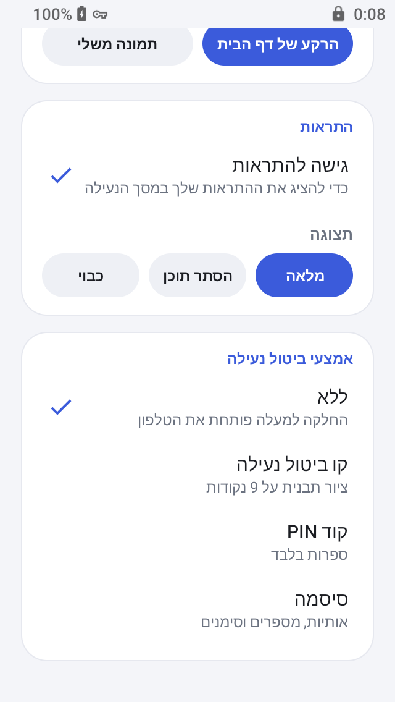

<div dir="rtl">


# מסך נעילה

מסך נעילה חלופי לאנדרואיד: נקי, מודרני ומהיר, במקום מסך הנעילה של המערכת.
הרקע הוא הרקע של דף הבית, השעון מעוצב, וגלילה ארוכה למעלה פותחת את אמצעי הנעילה שבחרת: קו ביטול נעילה, קוד PIN או סיסמה.

<p align="center">
  
  
  
</p>
<p align="center">
  
  
</p>

## 🎬 רילס

<a href="reel/LockScreen-Reel.mp4"></a>

סרטון אנכי של 20 שניות (‎1080×1920) לאינסטגרם, טיקטוק ושורטס: [reel/LockScreen-Reel.mp4](reel/LockScreen-Reel.mp4).
הסרטון מרונדר מקוד: `reel/make-reel.ps1` מצייר כל פריים ב-Java ומקודד אותו עם ffmpeg.

## מה יש בה

- **הרקע של דף הבית** מאחורי השעון, או תמונה משלך.
- **8 סגנונות שעון**: מוערם, דק, עבה, קו מתאר, קלאסי, צדדי, דו־גוני ומחוגים.
- **8 צבעים** (כולל צבע שנלקח מהרקע), **3 גדלים** ו-**2 מיקומים**, עם תצוגה מקדימה חיה בהגדרות.
- **גלילה ארוכה למעלה** שעוקבת אחרי האצבע, עם תנועה רגועה ובלי קפיצות. הרקע נשאר חד.
- **גלילה למטה** מחזירה לשעון.
- **קו ביטול נעילה** חלק: הנקודה שעוברים עליה רק מודגשת קלות. וגם **קוד PIN** ו**סיסמה**.
- **התראות במסך הנעילה**: כרטיסי זכוכית לפי אפליקציה. החלקה הצידה מוחקת התראה, והקשה פותחת אותה אחרי ביטול הנעילה. אפשר גם להציג אותן בלי תוכן, או לכבות.
## אבטחה

- **הגנה מלאה** (שירות נגישות, מומלץ). כשהטלפון נעול:
  - אי אפשר למשוך את מגש ההתראות ואת ההגדרות המהירות.
  - תפריט הכיבוי נסגר.
  - כל אפליקציה שנפתחת מעל מסך הנעילה נשלחת מיד הצידה. זה כולל את ההגדרות, שמסתירות חלונות רגילים.
  - בזמן שיחה אפשר להשתמש רק במסך השיחה.
  - הנעילה עולה מיד באתחול, עוד לפני שהמערכת מסיימת לעלות.
- **ההגדרות מוגנות**: כדי לפתוח את האפליקציה, לשנות את אמצעי הנעילה או לכבות אותה צריך להזין את הקוד.
- **מוסתר מצילומי מסך**, מהקלטת מסך ומתצוגת האפליקציות האחרונות.
- הקוד נשמר **מוצפן** (‏PBKDF2-SHA256, ‏60,000 סבבים, salt אקראי) ונבדק ברקע.
- אחרי 5 ניסיונות שגויים יש המתנה שמתארכת בכל פעם. שינוי השעון בטלפון לא מקצר אותה.
- הנעילה עולה גם אחרי **הפעלה מחדש** של הטלפון.

## התקנה

1. מורידים את `LockScreen.apk` מ-[Releases](../../releases) ומתקינים. צריך לאשר "התקנה ממקורות לא ידועים".
2. פותחים את האפליקציה ומאשרים את ההרשאות. החובה היא **הצגה מעל אפליקציות אחרות**.
3. בוחרים אמצעי ביטול נעילה ומפעילים את המתג. כדאי ללחוץ "נעל עכשיו לבדיקה".
4. מפעילים **הגנה מלאה**: הגדרות ← נגישות ← "מסך נעילה – הגנה מלאה".
5. רק אחרי שווידאתם שהכול עובד, מבטלים את נעילת המערכת: הגדרות ← אבטחה ← נעילת מסך ← ללא.

> **הגנה מלאה וגישה להתראות באנדרואיד 13:** אם ההגדרה חסומה ("הגדרה מוגבלת"), פותחים את פרטי האפליקציה, לוחצים ⋮ ובוחרים "התרת הגדרות מוגבלות".

> **שימו לב:** זו נעילה של אפליקציה. היא מגינה מפני גישה מזדמנת, אבל היא פחות חזקה מנעילת המערכת. למשל, הפעלה מחדש במצב בטוח (Safe Mode) עוקפת אותה. אם משהו משתבש, מצב בטוח הוא גם הדרך לצאת.

דורש אנדרואיד 12 ומעלה. נבדק על אנדרואיד 13.

## בנייה

הקוד כתוב ב-Java, בלי ספריות חיצוניות.

- **בלי Gradle:** הסקריפט `build.ps1` בונה את ה-APK ישירות עם כלי ה-SDK (aapt2 ← javac ← d8 ← apksigner).
- **עם Gradle:** אפשר גם לפתוח את התיקייה ב-Android Studio.

```
powershell -ExecutionPolicy Bypass -File build.ps1
```

</div>
